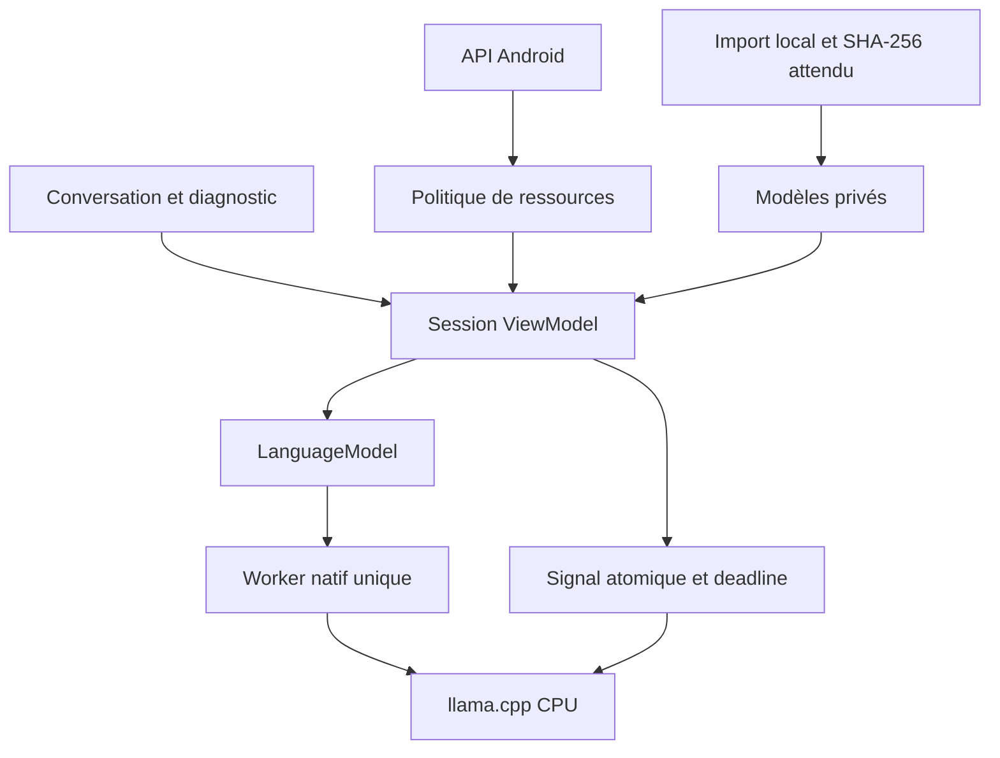

# Architecture du prototype

`domain` : sécurité pure, configurations, contrats de conversation et copie vérifiée.
`app` : interface, ViewModel, mesures système, stockage privé et adaptateur JNI.
`LanguageModel` : prepareOperation, load, generate, requestStop, unload, close.
Un backend futur peut remplacer llama.cpp sans reconstruire le métier.

## Concurrence et arrêt

Une opération utilisateur lourde à la fois ; boutons import/envoi/effacement désactivés pendant le travail.
L'arrêt reste disponible et l'état occupé persiste jusqu'au retour natif.
Chargement, génération, déchargement et destruction utilisent un worker unique ; seul le drapeau atomique est modifié concurremment.
Callbacks interruptibles pour progression du chargement et abandon du calcul CPU. Aucun délai coroutine présenté comme arrêt natif.
Certaines étapes de parsing/allocation/libération ne fournissent pas de point d'interruption immédiat.
Le délai d'arrêt d'un vrai Qwen sur Android reste à mesurer ; deux secondes ne sont pas annoncées comme atteintes.

## Modèles et contexte

Import borné, réserve disque, contrôle GGUF et SHA-256, remplacement atomique. L'import ne charge pas le moteur.
L'empreinte est revérifiée avant un nouveau chargement ; une interruption entre fichier et référence donne un refus sûr si ceux-ci divergent.
Avant les poids : architecture qwen3, quantification déclarée Q4_K_M et nombre de paramètres compatible.
Template du GGUF appliqué par llama.cpp ; préremplissage d'un bloc de raisonnement vide pour Qwen3 non-thinking.
Délimiteurs ChatML saisis neutralisés. Cela ne garantit pas la fiabilité du texte généré.
Tokenizer réel pour système + historique + question + sortie. Retrait des anciennes paires, ou refus si la question seule dépasse le budget.
Contexte natif vidé entre demandes. Historique : 40 messages affichés, six messages précédents au maximum transmis.

## Données et frontières

Conversation en RAM uniquement. Effacer retire la conversation de la session sans garantie d'effacement physique immédiat.
Modèles/empreintes dans le stockage privé ; sauvegardes cloud et transferts Android exclus.
Pas de chiffrement applicatif supplémentaire. Logs natifs désactivés, aucun contenu conversationnel journalisé.
Pas de RAG, mémoire persistante, action, connexion CORE/VOICE, serveur ou backend distant.
PLEINE PUISSANCE est réservée et refuse l'exécution mobile avant qualification dédiée.
