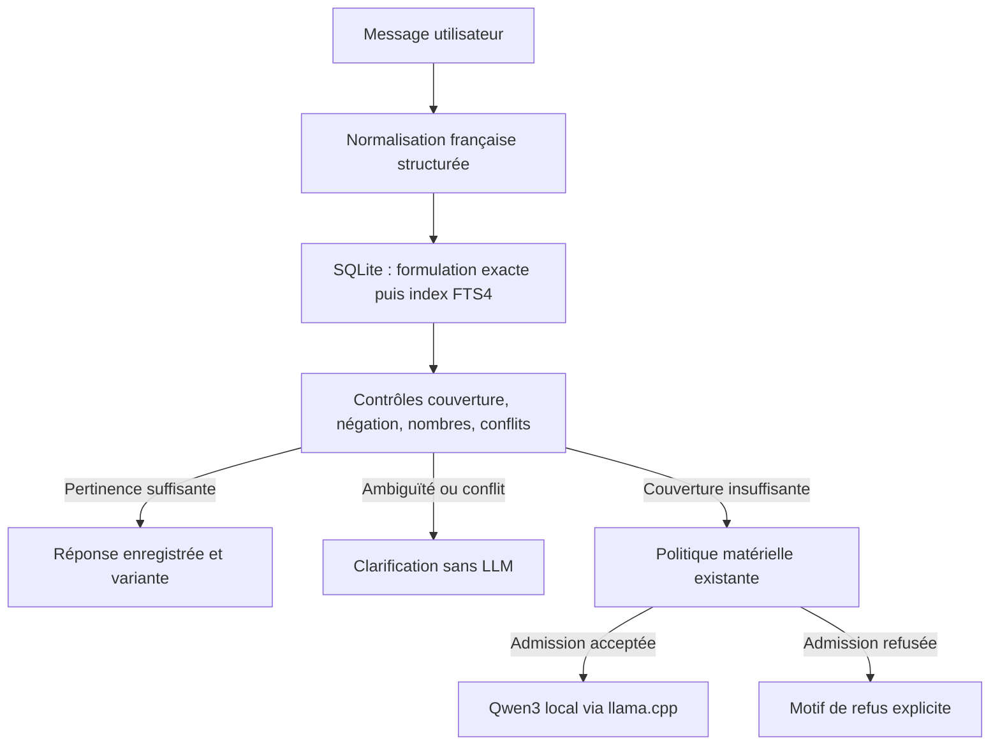

# Mission 003 — Catalogue local et compréhension des intentions

## Périmètre et architecture

Branche `mission-003-catalogue`, issue de `mission-002c-tablet`, APK 0.3.0 /versionCode 4. Application unique `fr.jarvis.llm` pour POCO et Redmi ; aucune modification de CORE, VOICE, INTERFACE ou main.

`AnswerRecord`, `KnowledgeSource` et `IntentRouter` sont dans le module JVM domain. `CatalogueStore` encapsule SQLite et `CatalogueJson` le format portable ; le ViewModel assure le routage et conserve le backend `LanguageModel` interchangeable. Les accès SQLite/SAF passent par IO et les opérations d'un store sont sérialisées. L'écran Catalogue est une activité interne de la même application, sans permission supplémentaire.
`RetrievalIndex`, `KnowledgeHit` (provenance catalogue/document/mémoire, révision, empreinte) et `SemanticRetriever` préparent le RAG et la mémoire. Un document futur sera une preuve à contextualiser, pas automatiquement une réponse éditoriale. Aucun RAG documentaire, mémoire de conversation persistante ni index vectoriel n'est activé dans cette mission.

## Données, variantes et versions

La base privée contient :

| Table | Rôle |
|---|---|
| answers | Identifiant stable, intention, catégorie, titre, révision, origine, suppression logique, payload courant |
| variants | Une à huit formulations de la même réponse, avec ordre stable |
| phrases | Une à douze formulations de la demande, texte brut et forme normalisée indexée |
| phrase_search | Index lexical FTS4, sans indexation de l'identifiant technique |
| revisions | Historique immuable des versions de chaque réponse |
| catalogue_meta | Version du normaliseur ; incompatibilité exige une migration explicite |

Le catalogue initial contient **8 réponses de démonstration**, dont une salutation à deux variantes. Une variante unique est pleinement supportée. La rotation est déterministe par session, bornée à 128 identifiants, jamais entre réponses concurrentes. Les variantes doivent conserver le même sens : ce n'est pas un mécanisme de choix entre faits contradictoires.
Les exemples synthétiques ne sont pas intégrés au catalogue par défaut. Un générateur produit 1 500 entrées `SYNTHETIC`, chacune marquée TEST SYNTHÉTIQUE, et deux petits fichiers de test pour variantes/conflits. Les sorties synthétiques sont aussi signalées dans la conversation.
Les modifications incrémentent la révision et vérifient la révision attendue. La suppression retire la réponse de la recherche mais conserve une tombstone versionnée et l'historique. **Elle n'efface pas physiquement le texte de la base.** Cette limite est annoncée dans la confirmation ; une purge physique est hors périmètre.

## Importation, édition, suppression, export

Format JSON version 1 : `formatVersion` et `answers`. Chaque entrée contient exactement `id`, `intent`, `title`, `category`, `revision`, `examples`, `variants`, `origin`, `deleted`. Les origines sont `DEMO`, `USER`, `SYNTHETIC`. Identifiants/intention : a-z, chiffres, point, tiret, underscore ; champs et nombres sont contrôlés strictement.
La lecture UTF-8 est incrémentale avec `JsonReader`, refus des caractères invalides, champs dupliqués/inconnus, versions futures, nombres non entiers, tailles/nombres excessifs et contenus structurés inattendus. Aucun script, HTML ou SQL provenant du fichier n'est exécuté.
Bornes : fichier 8 Mio, 5 000 identifiants **suppressions incluses**, 12 exemples de 500 caractères, 8 variantes de 2 000 caractères. Le volume courant compact est limité à 8 Mio moins 64 Kio pour assurer un export réimportable. Base SQLite plafonnée à 64 Mio ; cache pages cible de 2 Mio, pas un plafond global de mémoire de processus.
L'import est prévisualisé puis fusionné dans une transaction :

- ID absent : insertion de la révision fournie.
- Même révision et même contenu : sans effet.
- Même révision mais contenu différent, ou révision inférieure : refus de **tout** le fichier, sans changement partiel.
- Révision supérieure : nouvelle version et remplacement du contenu courant.
- Réimport ancien après suppression : refus ; une restauration nécessite une version supérieure explicite.

Les migrations de schéma/index exigent du code explicite ; aucune remise à zéro destructive automatique. L'historique finit par atteindre le quota : les écritures sont alors refusées, sans effacer arbitrairement des versions.
L'export conserve les versions courantes, y compris les tombstones, sous transaction et en flux, sans charger toute la base en RAM. L'historique complet n'est pas inclus dans le JSON portable. Un échec SAF peut laisser un fichier de destination incomplet : il faut le supprimer ; aucune atomicité du fournisseur de documents n'est promise.

## Reconnaissance et arbitrage

La recherche privilégie une formulation complète normalisée exacte. Sinon, FTS4 effectue une recherche conjunctive sur les tokens normalisés, avec au plus 20 réponses candidates et une détection de dépassement. Les réponses actives partageant une intention sont ajoutées pour ne pas cacher un conflit derrière des formulations différentes. Aucun corpus complet n'est chargé à chaque demande.
Le reconnaisseur combine :

- Accents, apostrophes et casse normalisés ; mots fonctionnels retirés.
- Synonymes ciblés et petites règles de paraphrase auditables : « tu marches quand il n'y a pas de connexion » peut rejoindre « fonctionnes-tu sans Internet ».
- Polarité négative, nombres et type interrogatif conservés ; « pourquoi » et « comment », 10 et 20 ne sont pas interchangeables.
- Couverture de la demande, couverture de l'exemple et séquence de bigrammes ; seuil 0,86, couverture >=0,95, marge >=0,16 hors correspondance exacte. Ces scores sont des heuristiques, **pas des probabilités calibrées**.
- Collisions de formulations, concurrence dans une même intention et oppositions simples entre variantes : clarification, sans chargement du LLM.

Les variantes explicitement opposées de même forme (disponible/indisponible, nombres différents pour la même assertion) sont bloquées. Cela **ne détecte pas toutes les contradictions factuelles de textes libres**. La curation reste nécessaire.
Les demandes vagues proposent jusqu'à trois options ; le prochain numéro sélectionne une formulation qui est recherchée à nouveau dans SQLite. Les options ne forcent pas une réponse si le catalogue a changé. Une nouvelle demande annule les options précédentes. Ce mécanisme reste simple, sans gestion générale des coréférences/pronoms ; ces cas retombent sur le LLM et ses protections.
La méthode reconnaît davantage qu'un mot-clé isolé, mais n'est pas une compréhension sémantique générale. Des paraphrases éloignées ou non représentées seront manquées. Un faux négatif prudent est préférable à une réponse enregistrée arbitrairement appliquée.

## Lexical ou embeddings locaux ?

| Approche | Coût et qualités | Décision |
|---|---|---|
| SQLite FTS4 + formulations/structure | Petit index, requêtes bornées, pas de poids de modèle ni JNI llama ; contrôle des nombres/négation | Activé et testé |
| Embeddings multilingues locaux, par exemple multilingual-e5-small | Paraphrases plus éloignées ; risque de rapprocher des phrases opposées ; index et modèle à qualifier | Interface préparée, désactivé |
| Classification par Qwen3 à chaque recherche | Réutilise le LLM mais impose un chargement même pour Bonjour | Non retenu pour le routage simple |

Ordres de grandeur **théoriques, non mesurés ici** pour un encodeur ~118 M paramètres : poids INT8 ~113 Mio, FP32 ~450 Mio, auxquels ajouter tokenizer, opérateurs, buffers et runtime. Un vecteur FP32 de 384 dimensions représente 1 536 octets : environ 2,2 Mio pour 1 500 prototypes ou 7,3 Mio pour 5 000. Encoder chacune des 12 formulations multiplie ce coût. La taille quantifiée ne garantit ni RAM réelle ni qualité française.
Avant activation : choisir/versionner exactement le modèle et sa licence, mesurer PSS et latence sur Snapdragon 680/POCO, vérifier négations/nombres/faux positifs sur un jeu représentatif, respecter la réserve système et l'annulation, invalider les vecteurs selon empreinte modèle/révision/normaliseur. Le mode PLEINE PUISSANCE futur pourra avoir un autre backend, mais ne doit pas rendre acceptables des conflits éditoriaux.

## Protections et fonctionnement hors ligne

Qwen3, llama.cpp, quantification Q4_K_M et profils ÉCO, ÉQUILIBRÉ, AUTO, TABLETTE ÉCO et réservation PLEINE PUISSANCE sont préservés. Aucune modification de SafetyPolicy ou de l'annulation JNI. Une demande non couverte passe par la même admission matérielle qu'avant ; aucun contournement par le catalogue.
Une réponse du catalogue ou une clarification décharge un éventuel modèle résident et n'appelle pas le constructeur du backend. Avant d'ouvrir le gestionnaire, la libération native est attendue. Les petites lectures de catalogue restent possibles sans admissibilité du LLM, par exemple avec 3,24 Gio disponibles ; ce n'est pas un abaissement du budget du modèle.
Les imports/éditions/exports du gestionnaire vérifient premier plan, batterie >=10 %, thermique connu 0..2, prévision thermique <1 si disponible, absence de low-memory, stockage interne libre >=256 Mio et réserve système inchangée + **128 Mio d'enveloppe supplémentaire estimée**. Cette enveloppe n'est pas un pic PSS démontré. Import/export contrôlent l'annulation et les capteurs par blocs/entrées. Lecture bloquante d'un fournisseur, parsing et commit ne sont pas immédiatement interruptibles.
Ni permission INTERNET ni API cloud, téléchargement intégré, service permanent, microphone, action système ou connexion à un autre JARVIS. Les documents SAF doivent être choisis dans le stockage local pour les essais en mode avion.

## Validation et limites matérielles

Les tests couvrent import atomique/idempotent, collision/ancienne révision, édition concurrente, suppression/non-résurrection, export aller-retour, variante unique/rotation, paraphrases inédites, négation/nombres/relation inversée, collisions/contradictions, dépassement de candidats, démarrage/hors ligne sans bibliothèque llama disponible et 1 500 entrées synthétiques.
La mesure du passage à l'échelle est produite par le test réel SQLite natif sous Robolectric API35 : durée import, 20 recherches, taille SQLite et pic **échantillonné du tas Java Linux/JVM**. Ce n'est pas un PSS Android et les allocations SQLite natives sont hors de ce tas. Pas de garantie sur les pointes transitoires ni de seuil de vitesse déduit pour la Redmi.
Votre retour utilisateur — plusieurs réponses Qwen3 0.6B, déchargement observé et arrêt manuel 1–2 s sur Redmi — est une qualification initiale encourageante, non reproduite par le cloud, sans garantie du délai sous toutes charges. Mission 003 n'effectue aucun essai physique ou benchmark intensif.
Résultats et publication exacts : [VALIDATION.md](VALIDATION.md). Essais courts : [TEST_CATALOGUE_003.md](TEST_CATALOGUE_003.md).
