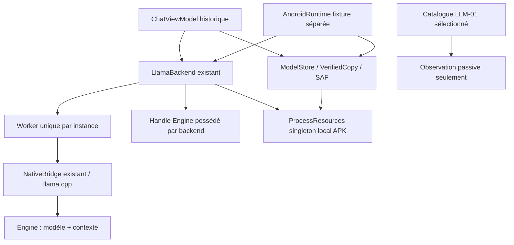

# L2 — dossier F3B, non appliqué

Références intégralement relues : F3A [AUDIT](../mission-003f-f3a/AUDIT.md),
[PORT-ET-RECUS](../mission-003f-f3a/PORT-ET-RECUS.md),
[ADAPTATION-SENSIBLE](../mission-003f-f3a/ADAPTATION-SENSIBLE.md), puis F3B
[DIFF-A-APPROUVER](../mission-003f-f3b/DIFF-A-APPROUVER.md) et
[patch exact](../mission-003f-f3b/SENSITIVE.patch).

Empreinte SHA-256 inchangée :
`be4bcce5ec7066851a09e2e372edca562a45dad3a3a88e35b6a7d5792c07b374`.
L'outil `python3 tools/review-fusion-02-native.py` vérifie les sept préimages,
l'absence des trois fichiers proposés nouveaux et `git apply --check`.
Il produit `build/fusion-02/native-review.json`, **sans appliquer le patch**.
Une vérification sèche ne compile pas le backend modifié et ne prouve pas le JNI.

## Graphe réel et propriété

Les flèches ChatViewModel/AndroidRuntime décrivent deux compositions d'APK distinctes,
pas une activation simultanée de deux moteurs dans un même processus. `create`
est actuellement dans le constructeur ; begin/cancel sous handleLock sur le thread
appelant. Le worker sérialise load/generate/mesure fixture/unload/destroy, mais son
inactivité seule ne couvre donc pas tous les appels JNI et les imports SAF.
Le backend demeure l'unique propriétaire de ses MODEL/HEAVY ; aucun lease nouveau
n'est acquis par le client, le banc ou l'observateur.

## Diff, ABI, imports et risques

| Fichier du patch | Modification envisagée | Vérification indispensable après accord |
|---|---|---|
| bridge.cpp | observeOwned sur l'Engine existant, tableau ABI1 de quatre longs | UAF sur handle périmé, course cancel/destroy, allocations JNI/OOM ; ASan/UBSan hôte et tests JNI réels |
| LlamaBackend.kt | Hook optionnel ; suivi avant dispatch et après vrai retour worker | Ordre worker→handleLock→coordinateur, annulation avant entrée, fermeture du dispatcher, aucun faux finally=fin |
| F3NativeApi.kt nouveau | Décorateur NativeApi déléguant au même Engine | Retour en erreur distinct du crash sans retour ; observateur défaillant après destroy ne provoque pas double destroy |
| F3Trace.kt nouveau | Compteurs tâches/imports/JNI, cap128, clés/retours | Exhaustivité, saturation fermée, coût RAM à mesurer ; métadonnées sans texte ni chemin privé |
| F3BackendObservation.kt nouveau | Projection corrélée trace+baux réels | Pas de fabrication d'ATTEST, pas de compteur doublant les baux |
| ResourceCoordinator.kt | Identités/révisions des baux en lecture atomique | ABA, ancien retour relâchant nouveau bail, changement partagé avec APK historique |
| fixture AndroidRuntime.kt | Trace liée avant import/factory, flux suivis jusqu'au retour | Imports hors worker et ouverts, runtime/service recréé ; null/PID neuf ≠ unload |

Imports du dispositif proposé : NativeApi/LanguageModel existants, types de ressources
domaine et coroutine/worker déjà utilisés ; trois classes F3 dans le namespace engine
seraient ajoutées. Aucun nouveau moteur, dépendance AAR, permission ou IPC n'est
nécessaire pour la sonde brute. Les imports exacts restent dans le patch épinglé ;
ils ne sont pas ajoutés aux sources main par FUSION-02. L'init Gradle existant ne
compile F3NativeApi/F3Trace candidats qu'en **sources de test**.

ABI actuelle Android : ARM64, minSdk29/target36, NDK28.1.13356709, alignement16Kio.
JNI actuel : handle de type jlong pointant Engine ; la sonde supplémentaire reste
non compilée/non exportée par cette mission. APK historique et fixture séparées,
signatures distinctes ; permission de signature de fixture préservée, aucune clé
publiée ni rotation. Compiler cette proposition exigera revue explicite de l'ABI.

## Tokenizer exact — lacune distincte

Les fonctions natives de template/tokenizer et la mesure texte synthétique de
fixture existent, mais NativeTokenCountPort structuré reste UNSUPPORTED. Le patch
F3B n'implémente pas prepare/consume/discard ni la liaison atomique avec modèle,
template, clé, contexte demandé, worker, génération et bail. Il faut vérifier une
seule composition SYSTEM, même rendu et même tokenizer pour comptage/génération,
aucune troncature silencieuse de la question, et refus si contexte insuffisant.
Aucun remplacement par taille UTF-8, estimation NEXUS ou chiffre fictif n'est admis.

## Accès modèle, baux et preuves de fin

Import volontaire SAF, SHA/taille et copie privée vérifiés par les composants
existants. Sélection ≠ worker actif, metadata déclarative ≠ architecture qualifiée.
Les imports/flux ouverts participeraient au drain ; aucune factory pour observer.
STOP_REQUESTED suit le drapeau ; DRAINED exigerait tous les appels/queues/imports
terminés ; UNLOADED exigerait en plus modèle/contexte libérés, baux fermés et reçus
opération/bail/incarnation exacts. Échec nettoyage/retour manquant : UNKNOWN ou
CLEANUP_FAILED. Un unload réussi ne signifie jamais PSS/RSS zéro.

Même approuvé, le patch brut ne suffit pas à ouvrir /2 : barrière exhaustive,
reçus durables, corrélation des mandats CORE et qualification Android manquent.
COORD-001 n'est pas présumé qualifié ; aucun nouvel arbitre global n'est créé.

## Plan de retour arrière proposé, non exécuté

Conserver cette base immuable, APK et signatures de laboratoire séparées. Une
future adaptation doit rester opt-in, sans ouvrir l'admission /2 ni changer les
stores. En cas d'échec : fermer l'admission, conserver journaux/UNKNOWN, demander
l'arrêt exact et attendre des preuves réelles ; ne pas revenir à une branche
ancienne pour prétendre que ses ressources sont libres. Le retour de code se fera
par revert auditable de la seule adaptation après revue, jamais force-push,
réinstallation personnelle, suppression de preuves ou migration de données.

**Décision requise** : autorisation spécifique du diff exact pour une mission
native distincte, puis qualifications successives. Aucune application, installation,
connexion CORE004D ou activation FULL_POWER n'est autorisée par FUSION-02.
